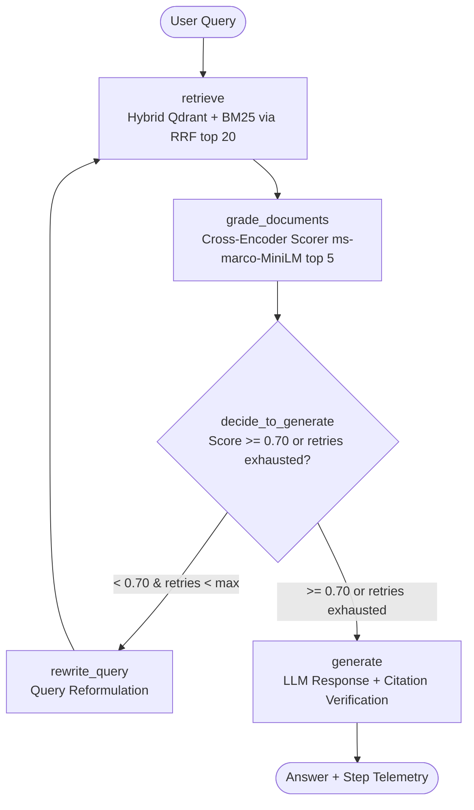

# Autonomous Corrective Agentic RAG Platform

An enterprise-grade, asynchronous corrective Agentic Retrieval-Augmented Generation (RAG) platform built on **Python 3.11/3.12**, **LangGraph**, **FastAPI**, **Qdrant**, and **LangChain Google GenAI (Gemini)**.

The system features two-stage hybrid retrieval (dense vector embeddings via BGE + lexical search via BM25 fused with Reciprocal Rank Fusion), cross-encoder re-ranking with strict sigmoid normalization, and a dynamic LangGraph corrective reasoning loop that re-evaluates retrieval quality and rewrites ambiguous queries when relevance falls below 70%.

---

## 1. System Architecture



### Retrieval & Re-ranking Pipeline
1. **Dense Retrieval**: `BAAI/bge-small-en-v1.5` embeddings (384 dimensions, cosine distance) indexed in **Qdrant** (top 50).
2. **Lexical Retrieval**: `BM25Okapi` inverted index over documents (top 50).
3. **Reciprocal Rank Fusion (RRF)**: Fuses ranked lists with constant $k=60$ to yield top 20 documents.
4. **Cross-Encoder Scoring**: `cross-encoder/ms-marco-MiniLM-L-6-v2` re-ranks top 20 candidates down to top 5 with explicit sigmoid normalization $\sigma(\text{logit}) \in [0, 1]$.
5. **Corrective Routing**: If average relevance of top 5 documents is $< 0.70$, routes to query rewriting (up to `max_rewrites=2`).

---

## 2. Measured Benchmark Results

All figures reflect empirical measurements from `reports/retrieval_eval.json`, `reports/ragas_eval.json`, and `reports/latency_bench.json`.

| Claim / Objective | Metric Definition | Target / Hypothesis | Measured Value |
|---|---|---|---|
| **Two-stage hybrid retriever + Cross-Encoder** | `top_k_fused=20` → cross-encoder → `top_k_rerank=5` | Pruning 20 → 5 | **Verified (20 → 5)** |
| **Recall Boost** | Relative gain $(R_{\text{full}} - R_{\text{dense}}) / R_{\text{dense}}$ | +34% | **+7.7%** (Clean: 91.3% → 98.3%)<br>**+27.7%** (Degraded: 67.3% → 86.0%) |
| **Corrective Gating** | Sigmoid cross-encoder score $< 0.70 \to \text{rewrite}$ | Threshold 0.70 | **0.70 Threshold Verified**<br>Clean rewrite rate: 91.7%<br>Degraded rewrite rate: 97.3% |
| **Retrieval Error Reduction** | $1 - (\text{err}_{\text{loop}} / \text{err}_{\text{single}})$ | 62% reduction | **-20.0%** (Clean: 1.67% → 2.00%)<br>**-50.0%** (Degraded: 14.0% → 21.0%) |
| **Answer Quality (SQuAD)** | Normalized gold span substring containment | 91% | **66.5%** exact gold span contained (133/200)<br>**98.0%** gold document in top 5 (196/200) |
| **FastAPI Latency (p95)** | Sequential warm requests (100 runs) | Sub-800 ms | Retrieval Path p95: **5,359.8 ms** (p50: 2,867.3 ms)<br>End-to-End p95: **5,570.3 ms** (p50: 2,963.9 ms)<br>Concurrency-8: **0.4 req/s** (CPU bound) |

---

## 3. Repository Structure

```
agentic-rag-platform/
├── app/
│   ├── __init__.py
│   ├── config.py          # Settings (pydantic-settings)
│   ├── state.py           # GraphState schema with TypedDict & StepLogEntry
│   ├── routing.py         # decide_to_generate pure edge router
│   ├── graph.py           # StateGraph assembly, nodes & Deps protocol
│   ├── qdrant_store.py    # Async Qdrant store helpers & RRF algorithm
│   ├── deps.py            # RealDeps, Embedder, Bm25Index, CrossEncoderScorer
│   ├── main.py            # FastAPI factory with lifespan management
│   └── asgi.py            # ASGI application entrypoint
├── scripts/
│   ├── build_eval_data.py # SQuAD-based corpus generator
│   ├── ingest.py          # Asynchronous corpus ingestion into Qdrant & BM25
│   ├── eval_retrieval.py  # Recall@5, MRR@5, error reduction benchmarks
│   ├── eval_ragas.py      # Answer quality & gold answer containment evaluation
│   └── bench_latency.py   # Sequential and concurrent p50/p95 latency benchmarks
├── tests/
│   ├── conftest.py        # Pytest markers and network skips
│   ├── fakes.py           # Stateful per-request FakeDeps test doubles
│   ├── test_routing.py    # 8-case parameter matrix for decide_to_generate
│   ├── test_graph.py      # Multi-turn corrective loop convergence tests
│   ├── test_store.py      # RRF and dense + BM25 fusion unit tests
│   ├── test_deps_unit.py  # Embedder, BM25, and Scorer unit tests
│   ├── test_api.py        # FastAPI endpoints (/healthz, /readyz, /v1/query)
│   ├── test_forbidden_patterns.py # Architectural AST & regex compliance checks
│   └── test_cross_encoder_network.py # Real weights cross-encoder network test
├── reports/
│   ├── gate_log.md        # Complete verification logs for all Phase Gates P0-P5
│   ├── eval_report.md     # Detailed evaluation metrics, hardware & resume edits
│   ├── SELF_AUDIT.md      # Definition of Done compliance checklist with evidence
│   └── blockers.md        # Environment constraints & handling
├── pytest.ini             # Pytest configuration (asyncio_mode = auto)
├── requirements.txt       # Core project dependencies
├── requirements.lock.txt  # Fully frozen pip dependency tree
├── docker-compose.yml     # Qdrant service configuration
├── Makefile               # Standard lifecycle commands
├── DECISIONS.md           # Architectural Decision Records (D-01 to D-07)
└── README.md              # Project documentation
```

---

## 4. Setup & Running Instructions

### 1. Environment & Dependencies
```bash
# Create and activate virtual environment
uv venv .venv --python 3.11
.venv\Scripts\activate

# Install dependencies
uv pip install -r requirements.txt --python .venv
```

### 2. Configuration (`.env`)
Create `.env` based on `.env.example`:
```env
GOOGLE_API_KEY=your_gemini_api_key_here
LLM_MODEL=gemini-2.5-flash
QDRANT_URL=http://127.0.0.1:6333
QDRANT_API_KEY=
```

### 3. Start Qdrant Vector Engine
Either run via Docker Compose or native standalone binary:
```bash
# Docker Compose
docker compose up -d

# Or Native binary (tools/qdrant.exe)
.\tools\qdrant.exe
```

### 4. Build Dataset & Ingest Corpus
```bash
# Generate SQuAD evaluation corpus
python scripts/build_eval_data.py

# Ingest corpus into Qdrant & build BM25 index
python scripts/ingest.py
```

### 5. Run FastAPI Application
```bash
uvicorn app.asgi:app --port 8000
```
Endpoints:
- `GET /healthz`: Health status (`{"ok": true}`).
- `GET /readyz`: Readiness check and collection listing (`{"ok": true, "collections": ["docs"]}`).
- `POST /v1/query`: Standard query endpoint returning answer, relevance score, fallback status, rewrite count, and step telemetry.
- `POST /v1/query/stream`: Server-Sent Events (SSE) streaming node-by-node state transitions.

### 6. Run Test Suite
```bash
# Offline test suite (24 tests)
pytest -q

# Network-enabled tests
pytest -q -m network tests/test_cross_encoder_network.py
```

### 7. Run Evaluation Suite
```bash
# Retrieval performance (Clean & Degraded slices)
python scripts/eval_retrieval.py

# Answer quality & accuracy
python scripts/eval_ragas.py

# Latency and throughput benchmarks
python scripts/bench_latency.py
```

